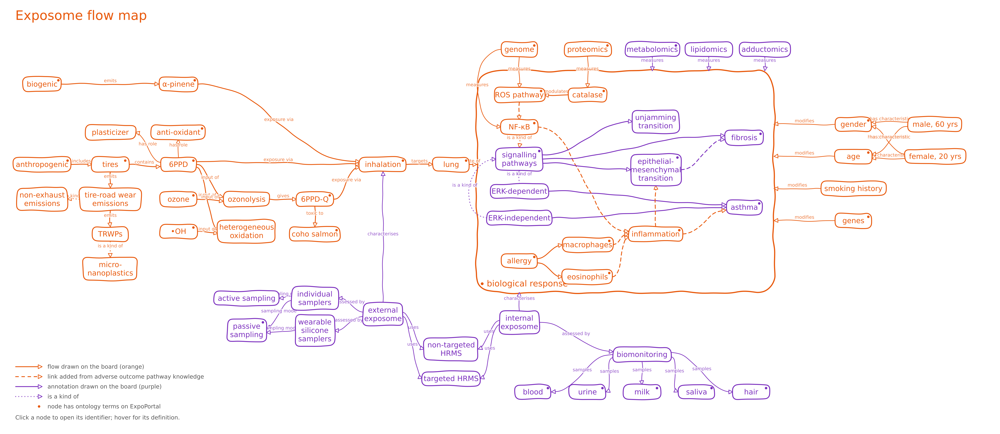

# Exposome blackboard: from photos to knowledge graph

Two blackboards with an exposome workflow, drawn on 2026-11-10, were
photographed, cleaned up into readable images, and turned into a knowledge
graph with a clickable map.

## Documentation

- [IMAGES.md](IMAGES.md): how the blackboard photos were combined into single
  readable images, and how the two boards were merged into one.
- [KG.md](KG.md): how the drawing was turned into a knowledge graph
  (Turtle and JSON-LD), a Mermaid diagram, a clickable SVG, and a web page
  ([exposome_map.html](exposome_map/exposome_map.html)) that shows the
  ontology terms of a node on hover.

## Contents

| Path | Content |
| :-- | :-- |
| `board1/`, `board2/` | The original photos. |
| `board1_combined.jpg`, `board2_combined.jpg` | One readable image per board. |
| `board_merged.jpg` | Both boards merged into one. |
| `exposome_map/` | The knowledge graph, the script that builds the diagrams, and the diagrams. |
